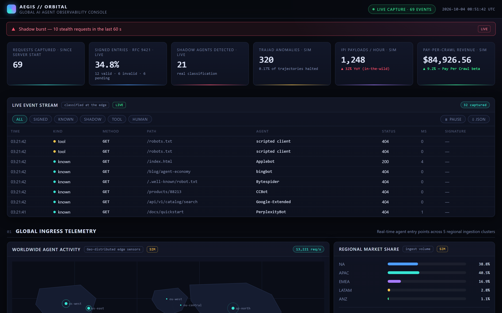
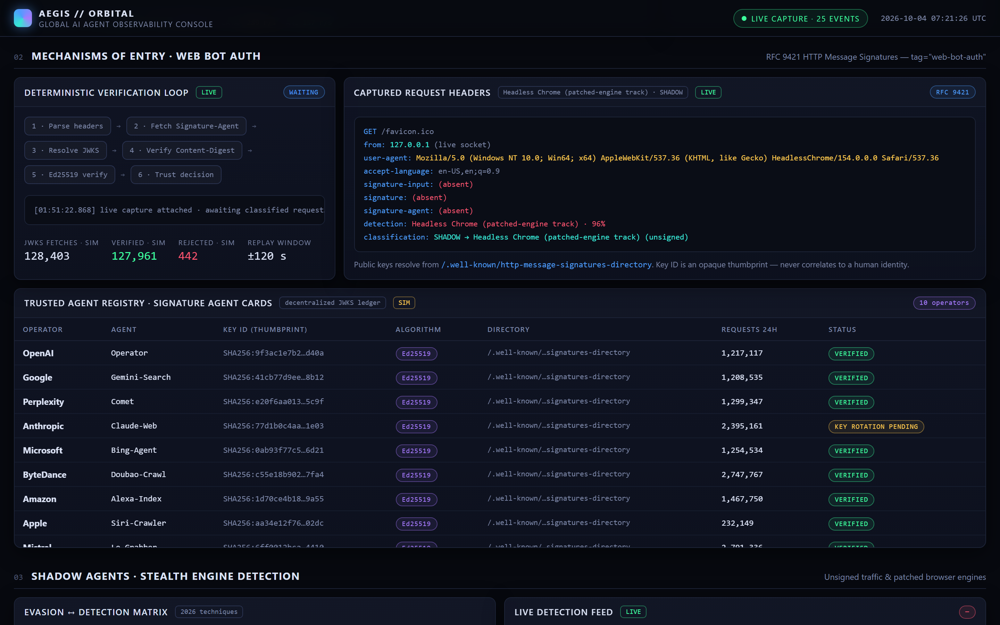
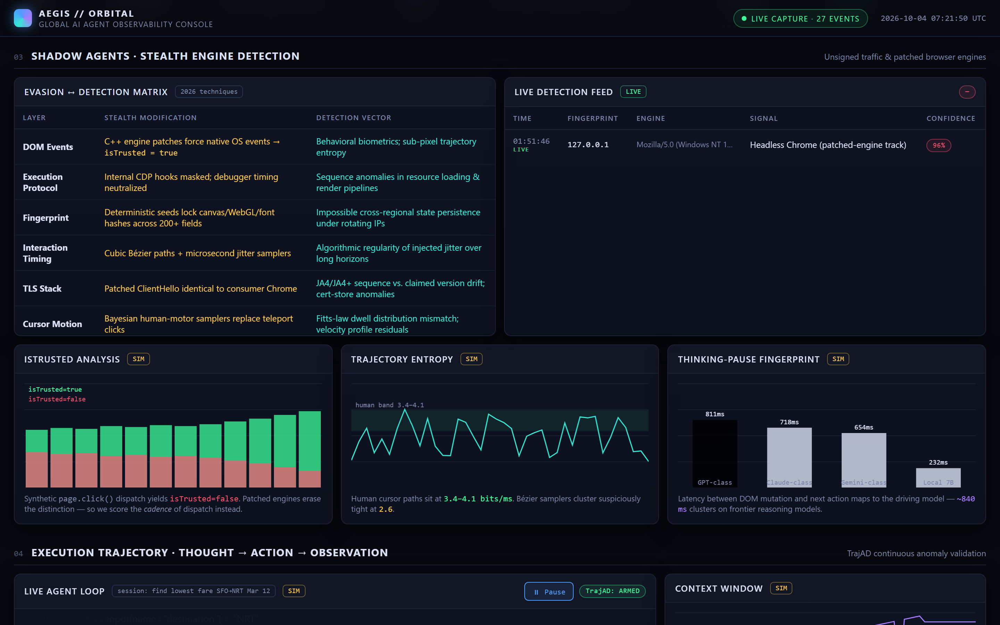

<!-- docs/assets/aegis-avatar.svg -->
<p align="center">
  
</p>

<h1 align="center">AEGIS</h1>

<p align="center">
  <strong>Global AI Agent Observability Console</strong><br/>
  Classify every request that reaches your edge — cryptographically <em>verify</em> signed agents,<br/>
  catch headless shadow traffic, and watch it all live.
</p>

<p align="center">
  <a href="https://github.com/anushms/aegis/actions/workflows/ci.yml"></a>
  <a href="LICENSE"></a>
  = 20" />
</p>

---

## What's real vs. simulated

The core of `server.js` is real: request classification, RFC 9421 signature
verification against your own JWKS keyring (spec-tested against the Appendix
B.2.6 vector), the ±120 s freshness window, SSRF-guarded remote key
resolution, `/metrics`, SSE streaming, Basic-auth RBAC and OTLP export — all
covered by the test suites. The derived signals are honest heuristics, not
learned detections: IPI is a regex match over the URL path and query,
`trajectory` fires on any path outside a small built-in scope list, and
`revenue` is a flat $0.0042 credited per valid signature. The console's
editorial panels are **simulated**
when no capture server is attached (or when you open `index.html` via
`file://`): the world map, regional-share bars, trajectory stream, IPI feed,
shadow matrix, market-context figures and the ticker model research findings
with randomly drifting data so the UI has something to show. They are tagged
`SIM` in the UI; panels fed by the server flip to `LIVE` and render raw
counters only. If a number is not tagged `LIVE`, it is a demo, not
telemetry.

AEGIS is a **zero-dependency** observability stack for the agent-filled web:

- **A capture server** that classifies every inbound request — `signed`, `known` crawler,
  `shadow` (headless/evasive), `tool` (scripted), or `human` — and **actually verifies
  RFC 9421 HTTP Message Signatures** cryptographically against a local JWKS keyring.
  Verdicts are literal: `VALID`, `INVALID`, or `UNRESOLVED`. Nothing is called verified
  that has not been verified.
- **A live console** that renders the stream over SSE: event table with filters and JSON
  export, a 10-minute rate chart, a shadow-burst detector, the Web Bot Auth verification
  loop with the real signature verdict, and clear `LIVE` / `SIM` tags on every panel.

The verification core is spec-tested against the **RFC 9421 Appendix B.2.6 Ed25519 test
vector** — if that vector verifies, the signature-base reconstruction matches the
specification byte-for-byte.

## Screenshots

| Live console — burst banner, KPIs, event stream | Signature verification — real verdict |
| --- | --- |
|  |  |

| Shadow-agent detection — matrix and live feed |
| --- |
|  |

## What it does

- **Real signature verification (RFC 9421).** Parses the `Signature-Input` /
  `Signature` structured fields, rebuilds the signature base (`"@method": …` lines,
  quoted component identifiers, `@signature-params`), and verifies Ed25519, RSA-PSS,
  RSASSA-PKCS1, ECDSA (P-256/P-384) and HMAC-SHA256 signatures. Enforces a Web Bot Auth
  profile: `@method`, `@path`, and `@authority` must be covered, with a ±120 s freshness
  window. Keys load from `JWKS_PATH` (mtime-reloaded) or programmatically — **keyid URLs
  are never dereferenced** (SSRF guard, see [SECURITY.md](SECURITY.md)).
- **Request classification** — every request falls into exactly one kind: `signed`,
  `known` (21 published agent UAs — GPTBot, ClaudeBot, PerplexityBot, Google-Extended,
  CCBot, Bytespider, …), `shadow` (headless/automation engines and browser claims
  without client hints, with confidence scores), `tool` (curl, python-requests, …), or
  `human`.
- **Live event stream** — filterable table (kind chips, pause, JSON export), real
  verdict counts in the KPI strip, a stacked rate chart in 10-second buckets, and a
  shadow-burst banner (≥ 8 stealth requests / 60 s, hysteresis on clear).
- **SSE delivery** — `GET /events` streams classified events; new clients hydrate from
  a snapshot so counters never restart at zero.
- **Access-log tailing** — point `LOG_PATH` at an nginx combined-format or JSON access
  log; signed JSON lines are verified too. No proxy required.

## Quick start

**Requirements:** Node.js 20 or newer. No `npm install` — there are no dependencies.

```bash
git clone https://github.com/anushms/aegis.git
cd aegis
JWKS_PATH=.demo-jwks.json node server.js      # or: npm start
```

Open <http://127.0.0.1:8788>. In a second terminal, generate a realistic mix —
including honestly signed requests (the script creates an ephemeral Ed25519 key,
publishes the public half for the server to load, then signs with it):

```bash
node scripts/demo-traffic.js
```

Expect **6 valid, 3 invalid, 3 unresolved** signature verdicts, 10 shadow requests, and
the shadow-burst banner within seconds.

**Configuration:**

| Variable          | Default      | Purpose                                    |
| ----------------- | ------------ | ------------------------------------------ |
| `PORT`            | `8788`       | HTTP listen port                           |
| `HOST`            | `127.0.0.1`  | Bind address (`0.0.0.0` in containers)     |
| `JWKS_PATH`       | *(disabled)* | JWKS file for signature verification (reloaded on change) |
| `LOG_PATH`        | *(disabled)* | Access log to tail (nginx or JSON lines)   |
| `JWKS_ALLOWLIST`  | *(empty — deny all)* | Exact `https://` origins allowed for remote JWKS fetches |
| `JWKS_PINS`       | *(disabled)* | Per-origin TLS SPKI pins: `origin=sha256/<b64>\|<hex>,…` |
| `JWKS_CA_FILE`    | *(system roots)* | Extra CA bundle (PEM) for private-PKI JWKS origins |
| `AEGIS_AUTH_USERS` | *(disabled)* | HTTP Basic auth: `user:pass:role,…` — roles `admin`, `viewer`, `metrics` (`/api/health` stays open for probes) |
| `AEGIS_ALLOW_INSECURE` | *(unset)* | Set to `1` to start a non-loopback `HOST` **without** `AEGIS_AUTH_USERS` — only when a proxy or network policy already authenticates. Without auth *and* without this flag the server refuses to bind. |
| `OTLP_ENDPOINT`   | *(disabled)* | Collector root (`http://host:4318`) — exports every event as an OTLP span to `/v1/traces` |
| `OTLP_FLUSH_MS`   | `3000`       | OTLP batch flush interval (50–60000 ms) |

**Prometheus:** `GET /metrics` exposes request counts by kind, verification
pass/fail ratios, a request-duration histogram, signal counters, auth
refusals (`aegis_auth_failures_total`), JWKS fetch results, and OTLP export
results (text exposition format 0.0.4). The scrape path is telemetry,
so it never inflates what it reports.

**Securing a remote deployment:** the default bind is `127.0.0.1`, which is
safe for local use. If you set `HOST=0.0.0.0` (containers do), you publish the
dashboard, the SSE stream and `/metrics` — the server **refuses to start**
unless you also set `AEGIS_AUTH_USERS` or explicitly opt in with
`AEGIS_ALLOW_INSECURE=1`. With credentials set, every route except
`/api/health` requires HTTP Basic login, with roles:

- `admin` — dashboard, snapshot, SSE, `/metrics`
- `viewer` — dashboard, snapshot, SSE (scrapers cannot use it for `/metrics`)
- `metrics` — `/metrics` only (for Prometheus)

```bash
# example: two viewers, one scraper token, one admin
AEGIS_AUTH_USERS="ops:s3cret:admin,dash:view:viewer,prom:scr4p3:metrics" node server.js
```

A malformed entry is dropped and a config with no parseable users denies
everything — typos fail closed. See [SECURITY.md](SECURITY.md) §7.

**Containers / Kubernetes:**

```bash
docker compose up --build            # http://localhost:8788
kubectl apply -k deploy/k8s/         # probes: /api/health + /api/snapshot
```

The multi-stage `Dockerfile` runs the full test suite inside the build stage,
ships a non-root minimal runtime, and declares a `HEALTHCHECK`. The image
binds `0.0.0.0`, so it starts only when `AEGIS_AUTH_USERS` is set or you opt
in explicitly with `AEGIS_ALLOW_INSECURE=1` — `docker compose up` and the
`docker run` below are local demos and opt in on purpose.

**Signed verification in a container** needs the keyring mounted — keys are
never baked into the image:

```bash
# placeholder keyring so the bind-mount source exists (the demo rewrites it):
printf '{"keys":[]}' > .demo-jwks.json
# AEGIS_ALLOW_INSECURE=1 is the explicit opt-in for an unauthenticated
# non-loopback bind; for anything beyond your own machine use
#   -e AEGIS_AUTH_USERS="user:pass:admin"  instead.
MSYS_NO_PATHCONV=1 docker run --rm -p 8788:8788 \
  -e JWKS_PATH=/app/.demo-jwks.json \
  -e AEGIS_ALLOW_INSECURE=1 \
  -v "$PWD/.demo-jwks.json:/app/.demo-jwks.json:ro" aegis:local
```

Without a mounted `JWKS_PATH` every signature is honestly `unresolved`
(fail-closed — nothing is trusted without a key). On Git Bash the
`MSYS_NO_PATHCONV=1` prefix stops Docker arguments like `/app/...` from being
rewritten to `C:/Program Files/Git/app/...`. Then run `node scripts/demo-traffic.js`
from the host — it fires at the published port and verifies the `/metrics`
scrape accounts for every request.

**Dashboard only:** open `index.html` directly in a browser — it is fully
self-contained and runs from its built-in simulation engine (`file://` pages never
attempt a live connection).

## Testing

```bash
npm test        # five suites (node:test — zero dependencies)
```

| Suite | Covers |
| --- | --- |
| `tests/verify.test.js` | **RFC 9421 Appendix B.2.6 test vector**, signature-base policy (coverage, freshness, keyring, algorithms), parser edge cases |
| `tests/jwks.test.js` | backoff math, `JWKS_PINS` parsing + fail-closed pin verification, background-queue gating/dedupe, live HTTPS transport (pin match/mismatch, redirects, size cap, timeout) |
| `tests/integration.test.js` | the real HTTP server on an ephemeral port: classification, verdict counters, snapshot shape, `/metrics` exposition, SSE hydration + broadcast + reconnect idempotence, per-path cardinality cap, Basic-auth role matrix (fail-closed), OTLP export (payload shape + failure counting) |
| `tests/server.test.js` | classification contract (known UA matrix, shadow confidence, tool-vs-shadow regressions), nginx/JSON log parsing |
| `tests/build.test.js` | `index.html` byte-synced to its sources, `src/` ↔ `app.js` bundle round-trip, self-contained page, honesty markers, remote-JWKS SSRF guard (default-deny), WebMCP inspector + schema validator |

CI runs the suite on Node 20, 22, and 24, syntax-checks every source file,
fails if a committed `index.html` drifts from `styles.css` / `src/*.js`, and
boots the server headless to run the demo traffic generator — the build fails
if `/metrics` does not account for every fired request.

## Project structure

```
index.html            generated, self-contained dashboard (the deliverable)
├── styles.css        theme + layout source
├── src/*.js          telemetry engine split into 16 modules (one per panel)
├── app.js            generated bundle of src/*.js — do not edit
└── build.js          bundles src/ → app.js → index.html (node build.js)
server.js             capture server: classifier, RFC 9421 verifier, /metrics, SSE, log tail
tests/                five node:test suites (npm test); fixtures/ = test TLS cert
docker-compose.yml    hardened single-host run (read-only, dropped caps)
Dockerfile            multi-stage: build+test gate → minimal non-root runtime
deploy/k8s/           Deployment (liveness/readiness probes) + Service + ConfigMap
scripts/demo-traffic.js   signed + shadow + bot traffic generator for demos
scripts/screenshot.js     headless-Chrome captures for the screenshots above
docs/                 screenshots, logo
SECURITY.md           threat model (SSRF guard, verdict semantics, reporting)
```

**Editing workflow:** change `styles.css` or a module in `src/`, run `npm run build`,
and commit the sources together with regenerated `app.js` and `index.html`. CI
verifies all four stay consistent.

## Troubleshooting

| Symptom | Cause / fix |
| --- | --- |
| `port 8788 in use` on start | Another instance is running — `PORT=8789 npm start`, or stop the other process. |
| Dashboard loads but the event stream is empty | Counters hydrate from the snapshot; the stream table fills with events that arrive **after** the page opened. Run `node scripts/demo-traffic.js` while the page is open. |
| All signatures show `UNRESOLVED` | The keyring has no matching `kid` — point `JWKS_PATH` at your JWKS (Docker: mount it, see Containers above). Fail-closed by design. |
| `401` on every page | `AEGIS_AUTH_USERS` is set — send Basic credentials (or remove the variable). `/api/health` never requires auth. |
| `403` for a valid user | The role does not cover that path: `viewer` cannot read `/metrics`, `metrics` cannot read the dashboard. |
| Docker on Git Bash: keyring not found | Git Bash rewrites `/app/...` args — prefix `MSYS_NO_PATHCONV=1` (see Containers above). |
| Demo exits 1 with `scrape check FAILED` | `/metrics` under-counted fired traffic — the accounting check found a real discrepancy; file an issue with the demo output. |
| Opened `index.html` via `file://` and everything is simulated | Expected: browser pages cannot open an SSE connection — all panels carry `· SIM` labels. Serve via `node server.js` for live capture. |

## Honest data labeling

The console distinguishes what it measures from what it models:

- `LIVE` — real requests captured by `server.js`: KPIs 1–3, the event stream, the rate
  chart, the shadow feed, and every signature verdict. `VALID` means a public-key
  verification actually succeeded against the local keyring; `UNRESOLVED` means the key
  is unknown — never presented as trusted.
- `SIM` — simulation of research findings and market forecasts (GEO
  citation economics, Pay-Per-Crawl revenue, IPI payload rates,
  trajectory-guard anomaly volume, the registry table).
  Each simulated panel is tagged in the UI.

## Security

Signature verification is designed to fail closed: unknown keys are `UNRESOLVED`,
never trusted; insufficient component coverage or an expired window is `INVALID`.
The server never fetches URLs found in `keyid` or `Signature-Agent` headers by
default — remote JWKS fetching is default-deny behind an operator allowlist,
with optional TLS SPKI pinning, exponential backoff, and bounded size/time/rate.
See [SECURITY.md](SECURITY.md) for the full threat model and reporting process.

`X-Forwarded-For` is read as-is for display and classification — a directly
connected client can spoof it, so treat logged client addresses as unverified
unless your reverse proxy overwrites the header.

## References

- [RFC 9421 — HTTP Message Signatures](https://www.rfc-editor.org/rfc/rfc9421.html)
- [Web Bot Auth](https://web-bot-auth.github.io/)
- [RFC 9309 — Robots Exclusion Protocol](https://www.rfc-editor.org/rfc/rfc9309.html)
- [GPTBot](https://openai.com/gptbot/)
- [Google-Extended](https://developers.google.com/search/docs/crawling-indexing/google-extended)

## Contributing

Contributions are welcome — see [CONTRIBUTING.md](CONTRIBUTING.md) for the
build/test workflow, the `String.replace` pitfall that will silently corrupt the
generated dashboard, and commit-message conventions.

## License

[MIT](LICENSE) © anushms
